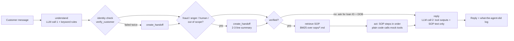

# Loan Servicing Agent (demo)

**Live demo:** https://loan-servicing-agent.streamlit.app/ (fake data; try the loan IDs and dates of birth listed in the sidebar)

A text-only AI customer-service agent for **Velmora Home Loans**, a made-up home-loan company (fake data, not related to any real lender).
It handles hard (L2/L3) requests the way a trained human agent would: it splits messages with **more than one request**, **verifies identity** before sharing any loan data, finds the **written SOP** for each request, calls **mock loan-system tools**, and **hands off to a human** (with a short summary) on fraud, anger, a request for a human, out-of-scope requests, or two failed identity checks.
Every tool call is logged and shown in the UI, and a **20-case eval suite** scores the agent from those logs.

## Architecture



- `src/loan_agent/graph.py` - the LangGraph flow (agent A: rules-first)
- `src/loan_agent/tools.py` - mock tools + call log (deterministic; loan-data tools refuse until verified)
- `src/loan_agent/retrieval.py` - BM25 over `sops/`
- `src/loan_agent/llm.py` - Gemini / Groq clients with retry + backoff, and a fake LLM for tests
- `app.py` - Streamlit UI · `evals/` - cases, scorer, results · `tests/` - pytest

## Run it locally

Needs [uv](https://docs.astral.sh/uv/) and a free API key from [Google AI Studio](https://aistudio.google.com/apikey) or [Groq](https://console.groq.com/keys).

```bash
git clone https://github.com/ksrinivasarao2012/loan-servicing-agent.git
cd loan-servicing-agent
uv sync                          # creates .venv and installs exact versions from uv.lock
cp .env.example .env             # Windows: copy .env.example .env  -> then paste your key(s)
uv run pytest                    # unit tests (no API calls)
uv run streamlit run app.py      # chat UI
uv run python evals/run_evals.py # real eval run (uses your API quota)
```

`LLM_PROVIDER` in `.env` picks `gemini` or `groq`; `GEMINI_MODEL` / `GROQ_MODEL` pick the model.

## Example conversation

A real exchange from eval run 4 (`evals/results_run4.json`, case C12: fraud report + a safe request in one message):

> **Customer:** HF1005 1982-12-03. I see a fraudulent transaction I did not make, and separately please tell me my foreclosure amount.
>
> **Agent:** Hello! Your outstanding principal is Rs. 3,100,000. Since your loan is on a floating rate, the foreclosure charge is 0%, making the total foreclosure amount Rs. 3,100,000.
>
> Next steps: pay the total by bank transfer to your loan account, then receive a closure letter, and you can then request property document release.
>
> Regarding your report of a transaction you did not authorise, a specialist will contact you with handoff ID HO-HF1005-001.

What the agent did (from the tool-call log):

| Step | Tool | Output |
|---|---|---|
| 1 | `verify_customer(HF1005, 1982-12-03)` | `true` |
| 2 | `create_handoff(HF1005, fraud_or_unauthorised_transaction, summary)` | `HO-HF1005-001` |
| 3 | `get_foreclosure_amount(HF1005)` | principal 3,100,000, floating rate, charge 0, total 3,100,000 |

Handoff summary sent to the human: *Reason: fraud_or_unauthorised_transaction. Customer said: "I see a fraudulent transaction I did not make". Loan ID: HF1005 (identity verified). Other requests in this message: foreclosure.*

## Eval results

Copied from [`evals/results.md`](evals/results.md) (full traces in `evals/results.json`). Deterministic checks only, no LLM judge.

- Agent: A (rules-first)  
- Model: `gemini:gemini-3.5-flash-lite`  
- Run at: 2026-11-25 04:29 UTC  
- Cases: 20, LLM calls: 49 (retries after rate limits included)

| Metric | Score |
|---|---|
| Intent accuracy | 20/20 (100%) |
| SOP / tool correctness | 20/20 (100%) |
| Escalation correctness | 20/20 (100%) |
| No hallucinated numbers/ids | 20/20 (100%) |
| Key facts in reply | 19/20 (95%) |
| No internal codes in reply | 20/20 (100%) |
| **Cases fully passed** | **19/20 (95%)** |
| BM25 top-1 SOP = intent (info only) | 19/20 |
| Cases hit by LLM/API errors (info) | 0 |

| Case | Category | Intent | SOP/tools | Escalation | Grounded | Facts | Clean | Pass | Notes |
|---|---|---|---|---|---|---|---|---|---|
| C01 | single-intent | ✅ | ✅ | ✅ | ✅ | ✅ | ✅ | ✅ |  |
| C02 | single-intent (identity given in 2nd turn) | ✅ | ✅ | ✅ | ✅ | ✅ | ✅ | ✅ |  |
| C03 | single-intent (claimed duplicate not found) | ✅ | ✅ | ✅ | ✅ | ❌ | ✅ | ❌ | reply missing ['21000'] |
| C04 | single-intent | ✅ | ✅ | ✅ | ✅ | ✅ | ✅ | ✅ |  |
| C05 | single-intent (floating rate, no charge) | ✅ | ✅ | ✅ | ✅ | ✅ | ✅ | ✅ |  |
| C06 | single-intent | ✅ | ✅ | ✅ | ✅ | ✅ | ✅ | ✅ |  |
| C07 | multi-intent | ✅ | ✅ | ✅ | ✅ | ✅ | ✅ | ✅ |  |
| C08 | multi-intent | ✅ | ✅ | ✅ | ✅ | ✅ | ✅ | ✅ |  |
| C09 | multi-intent (closed loan) | ✅ | ✅ | ✅ | ✅ | ✅ | ✅ | ✅ |  |
| C10 | multi-intent (identity given in 2nd turn) | ✅ | ✅ | ✅ | ✅ | ✅ | ✅ | ✅ |  |
| C11 | fraud | ✅ | ✅ | ✅ | ✅ | ✅ | ✅ | ✅ |  |
| C12 | fraud + safe request | ✅ | ✅ | ✅ | ✅ | ✅ | ✅ | ✅ |  |
| C13 | angry customer | ✅ | ✅ | ✅ | ✅ | ✅ | ✅ | ✅ |  |
| C14 | asks for a human | ✅ | ✅ | ✅ | ✅ | ✅ | ✅ | ✅ |  |
| C15 | out-of-scope | ✅ | ✅ | ✅ | ✅ | ✅ | ✅ | ✅ |  |
| C16 | out-of-scope + safe request | ✅ | ✅ | ✅ | ✅ | ✅ | ✅ | ✅ |  |
| C17 | failed verification (twice) | ✅ | ✅ | ✅ | ✅ | ✅ | ✅ | ✅ |  |
| C18 | failed verification (once, then correct) | ✅ | ✅ | ✅ | ✅ | ✅ | ✅ | ✅ |  |
| C19 | documents requested, loan not closed | ✅ | ✅ | ✅ | ✅ | ✅ | ✅ | ✅ |  |
| C20 | documents requested, loan not closed + foreclosure | ✅ | ✅ | ✅ | ✅ | ✅ | ✅ | ✅ |  |

**How to read this honestly:** a rules-first agent is *built* to score well on tool correctness, because plain code picks the tools. The one failure (C03) is real: the reply listed the three EMI dates but left out the amount (Rs. 21,000), which the case requires. The previous run included it, so this is the model's wording varying between runs, not a code bug. The case was left unchanged.

More generally, the high scores mostly show that the LLM parts (intent detection and grounded replies) held up on these 20 cases with this model. It does not prove the agent handles every real customer. The cases were written by me alongside the agent, not by an independent tester.

### Failures and what I changed

Every run is kept in `evals/` (`results_run1*.md`, `results_run2.md`, `results_run3_partial.md`, `results_run4.md`). No test case was changed to improve a score.

| Run | Result | What went wrong | What I changed |
|---|---|---|---|
| 1 (2026-11-24 02:34 UTC) | 20/20 on the 5 original checks | Reading the replies by hand: C13 told an angry customer about "the **very_angry_or_abusive** matter" (an internal code leaked). C08 opened with a garbled "thank honourable customer". | The reply prompt now gets plain words for handoffs, never reason codes. Added a 6th check, *no internal codes in reply*. Re-scoring run 1's saved replies with it gives **19/20** (`results_run1_rescored.md`). |
| 2 (2026-11-24 02:49 UTC) | **15/20** | From C15 on, every LLM call failed with a network error. The agent fell back to its safe path (hand off to a human), so C16-C20 failed and C15 passed by luck. The client only retried rate-limit errors, and the report did not say "API error". | Network errors are now retried with backoff, and each case reports LLM/API errors. |
| 3 (2026-11-24 08:14 UTC, C15-C20 only) | 6/6, 0 API errors | Reading the replies: C16's handoff summary said "identity not verified" although she was verified in the same message (handoffs were created before the identity check). C17's reply repeated "did not match twice". | Identity is checked before handoffs are created (handoffs still never *depend* on it). Shorter handoff wording. |
| 4 (2026-11-24 11:25 UTC) | 20/20, 48 LLM calls, 0 API errors | Reading the replies: C14 (angry + wants a human) got **two** handoffs and was told twice a specialist would call. C17's handoff summary put the agent's words ("Identity verification failed twice.") in quotes as if the customer said them. | One handoff per message: the most serious reason is the main one, others are listed as "(also: ...)". The summary quotes the customer's real message and lists what they were trying to do. |
| **Final (2026-11-25 04:29 UTC)** | **19/20**, 49 LLM calls, 0 API errors | C03 reply left out the EMI amount (see above). Checked by hand: C14 now has one handoff, C17's summary quotes the customer, every verification and foreclosure amount matches the data. | - |

**Still open (found by reading the final replies, not fixed):**
- Reply wording varies between runs (C03 above). A stricter reply template or a second check could catch missing facts, at the cost of another LLM call or less natural replies.
- Small style slips: replies sometimes repeat a fact for each request (C07 states the outstanding principal twice), and C14 says "share your complaint" a bit awkwardly.
- BM25 ranked the wrong SOP first in C20 ("how much to close the loan now?" scored higher for documents than foreclosure). The LLM's intent decides the SOP, so the result was not affected.

## Design decisions

- **Rules-first, LLM at the edges.** The LLM does what it is good at: understanding messy language (one call) and writing a polite reply (one call). Plain code does what must never go wrong: identity checks, which tools run and in what order, and when to hand off. Banks need behaviour they can predict, test and audit.
- **Safety in two layers.** Even if the agent code had a bug, the mock tools themselves refuse to return loan data for an unverified loan ID. Keyword rules for fraud and "I want a human" can only *add* a handoff, never remove one.
- **Human handoff is a feature, not a failure.** Fraud, anger, unknown requests and failed identity checks go to a person with a 2-3 line summary, while other safe requests in the same message are still completed.
- **Grounded replies.** The reply prompt only gets tool outputs and SOP text, and the eval checks that every number and id in a reply exists in those sources.
- **Small free-tier budget.** At most 2 LLM calls per turn; simple turns (like asking for a loan ID) use a template and only 1 call. Rate-limit errors are retried with exponential backoff.
- **Deterministic evals.** Scores come from the tool-call log and exact checks, with no LLM judge.

## Honest limitations

- Text only, fake data, 3 SOPs, 5 customers. Not production.
- Identity check is loan ID + date of birth only; a real lender would use OTP or other factors.
- BM25 cannot detect out-of-scope requests on its own with only 3 short SOPs (scores bunch together), so the LLM decides the intent and BM25 only fetches the SOP text. Its top-1 accuracy is reported for information.
- The tools, handoffs and refunds are mocks; nothing is persisted between app sessions.
- Eval numbers come from one run at temperature 0 with `gemini-3.5-flash-lite`; outputs can vary between runs and models (run 1 vs the final run already differed in wording). Groq is supported but was not evaluated.
- An "LLM plans the tool calls, code guards the rules" version (agent C) was planned for comparison but not built.
- The foreclosure policy is a demo: 0% on floating-rate loans mirrors RBI's (Pre-payment Charges on Loans) Directions, 2025; the 2% fixed-rate charge is the fake lender's own policy. Not legal advice.

## Deploy (Streamlit Community Cloud)

See [DEPLOY.md](DEPLOY.md).
